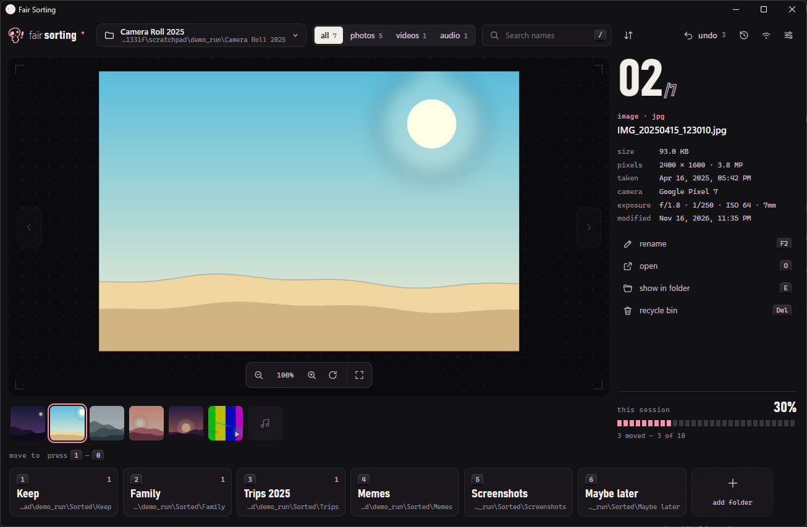
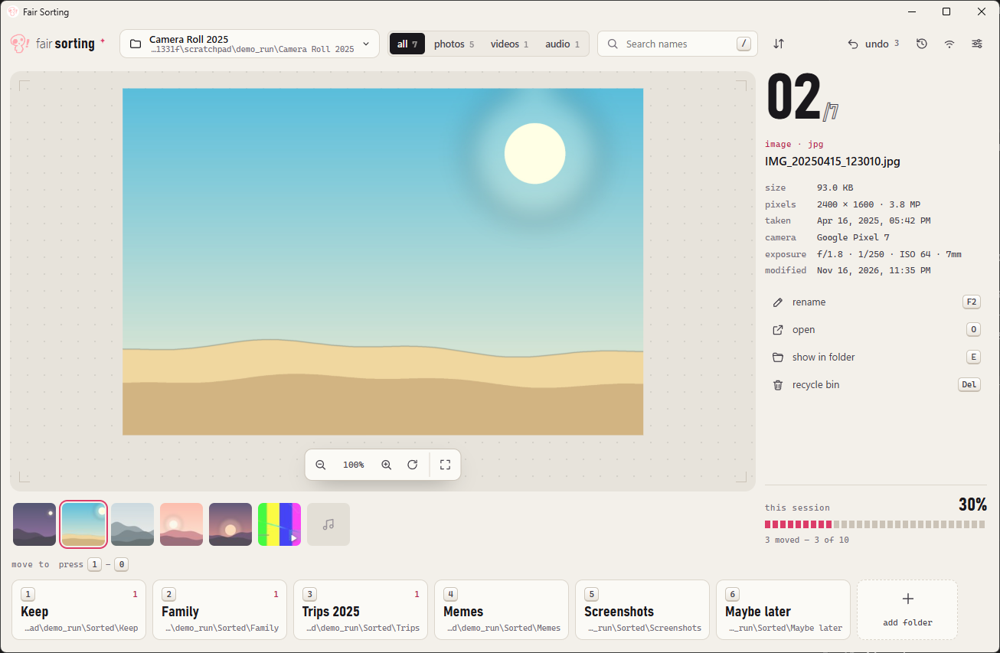

# fair-sorting

A manual media sorter for photos, videos and audio. Open a folder, add the folders you sort into, and press a number key to move each file. Every move is logged and can be undone, and the same interface runs in a desktop window or in any browser on your Wi-Fi.



> [!NOTE]
> Version 2 is a full rebuild. Your old `fair_config.txt` and every `move_log_*.txt` still work. If something misbehaves, please open an issue.

## What's new in 2.x

**2.2 — for photographers and videographers**

- **RAW done right.** Portrait shots from every major camera (CR3, CR2, NEF, ARW, RAF, RW2, ORF, PEF, DNG, IIQ, 3FR and more) now show upright. Fair Sorting reads the camera's embedded preview directly, so a RAW opens about as fast as a JPEG, with camera, lens settings and the real sensor size in the details.
- **RAW+JPEG and sidecars stay together.** One item per shot: the RAW, `.xmp` edits, `.THM`, drone `.SRT`, `.LRF`/`.LRV` proxies, Apple `.AAE` and Sony `C0001M01.XML` move, rename, go to the Recycle Bin and undo with their main file. Switch it off in Settings to see every file on its own.
- **Pro video just plays.** 10-bit and 4:2:2 footage (Sony XAVC S-I/HS, Panasonic All-I, Canon) is spotted up front and gets a quick, upright preview copy instead of a black frame. Vertical clips stay vertical. The details show the chroma sampling and bit depth.
- **Updates itself.** Fair Sorting checks GitHub when it starts, shows what's new, and installs the update in place with one click. Settings and move logs stay as they are, and every download is checked against its SHA-256.
- **More formats:** Insta360 `.insv`, GoPro MAX `.360`, AVCHD `.mts`/`.m2t`, DV, MXF, AIFF, CAF, BWF/RF64, WavPack, DSD and more. Blackmagic `.braw`, RED `.r3d` and Canon `.crm` can be sorted too (no preview).
- **Busy files are handled.** If a player or antivirus still holds a file, Fair Sorting waits a moment and retries instead of failing or leaving a half-copied duplicate.

**2.0 – 2.1**

- **One interface, two ways to open it.** The desktop app and the web version are now the same UI, so they look and behave identically.
- **Much lighter and faster.** Streamlit, OpenCV, pygame and numpy are gone. Photos and MP4/WebM/MP3 open instantly; only odd formats are converted, once, and cached.
- **Smarter playback.** Videos and audio play in the built-in player. AVI, WMV, MKV with AC3/DTS audio, WMA and friends are detected with ffprobe and converted automatically, with a progress bar.
- **Sort from your phone.** "Share on Wi-Fi" shows a QR code and a 6-digit PIN. No more open, unprotected web server.
- **As many destinations as you like:** number keys work in banks of ten (`[` `]` to switch), and `G` finds any folder by name or number.
- **Guided tour** on first launch that points at each part of the screen; replay it from Settings.
- **Endless undo:** `Ctrl+Z` walks back through this session and then the move log, even after a restart.
- **Album art for audio:** embedded covers or a `cover.jpg` / `folder.jpg` next to the tracks, with title, artist, album and year, a live visualizer and a cover that pulses with the beat.
- **Little bits of motion:** files fly into the folder you picked, counters roll, themes cross-fade. All of it switches off when Windows' reduce-motion setting is on.
- **New tools:** filmstrip with thumbnails, search, filters (photos/videos/audio), sort by name/date/size/type, include subfolders, rename (F2), Recycle Bin (Del), multi-step undo, labels for destinations, recent folders, session progress, EXIF details (camera, date taken, exposure), resume where you left off.
- **New look:** quiet ink/paper themes, condensed display type, mono details, a single pink accent from the mascot.




## Download

Head to the [releases page](https://github.com/ripaaf/fair-sorting/releases/) and pick one:

| Release | What it is | How to use |
| --- | --- | --- |
| `fair-sorting-setup.exe` | Installer | Double-click, press **Install**. Adds Start menu and desktop shortcuts; uninstall from Settings › Apps |
| `fair-sorting.exe` | Single portable executable | Download and double-click |
| `fair-sorting-app.zip` | Self-contained app folder (starts faster) | Extract, then run `fair sorting.exe` inside |

All three include FFmpeg. The installer installs just for you (no admin prompt) into `%LOCALAPPDATA%\Programs\Fair Sorting`, and running a newer Setup updates in place while keeping your settings. For scripted installs: `fair-sorting-setup.exe --silent [--dir D:\Apps] [--no-desktop]`. Windows 10/11 with the Edge WebView2 runtime (already on Windows 11) is all you need.

## How to use

1. **Choose a folder** to sort (`L`). Recent folders are one click away.
2. **Add destinations** (`A`). Pick several at once; each gets a number key.
3. **Sort**: press `1`–`0` to move the current file.
   Got more than 10 destinations? They're grouped in banks of ten: `[` / `]` switches the bank the number keys use, `Shift`+`1`–`0` reaches the next bank directly, and `G` opens a picker where you type a name or a number (`23` + `Enter`).
4. **Undo** with `Ctrl+Z`, as many steps back as you need. Once this session's moves are undone it keeps going back through the move log, so it still works after you restart the app.

The first time you open Fair Sorting a short guided tour walks you through these steps. Replay it any time from Settings › Help.

Moved files never overwrite anything: a name clash becomes `name_1.jpg`, `name_2.jpg`, and so on (a RAW+JPEG set keeps one shared number: `name_1.jpg` + `name_1.cr3`).

Fair Sorting looks for a new version on GitHub when it starts (turn it off in Settings › Updates). When there is one, the gear icon gets a dot; open it to read what's new and press **Download & install**.

## Keyboard shortcuts

| Key | Action |
| --- | --- |
| `1` – `0` | Move to a destination in the active bank (1–10 by default) |
| `Shift` + `1` – `0` | Move to a destination in the next bank (11–20 by default) |
| `[` / `]` | Switch key bank: 1–10, 11–20, 21–30 … |
| `G` | Move to any destination by name or number |
| `Ctrl+Z` | Undo (repeat to go further back, all the way through the move log) |
| `Del` | Move to the Recycle Bin |
| `F2` | Rename |
| `←` / `→` | Previous / next file |
| `Home` / `End`, `PgUp` / `PgDn` | First / last, jump 10 files |
| `/` or `Ctrl+F` | Search names |
| `F5` or `Ctrl+R` | Rescan the folder |
| `Space` / `P` | Play or pause |
| `S` | Stop and go back to the start |
| `J` / `K` | Back / forward 5 seconds |
| `M` | Mute |
| `+` / `-`, `Ctrl+0` | Zoom in / out, reset zoom (mouse wheel and double-click work too) |
| `R` | Rotate the view |
| `O` | Open in the default app |
| `E` | Show in Explorer |
| `L` / `A` | Choose source folder / add destinations |
| `F` | Focus mode (full screen, panels hidden) |
| `H` | Hide the side panels |
| `T` | Night / day theme |
| `C` | Move the sort keys: bottom, left, right |
| `?` | Show all shortcuts |
| `Esc` | Close whatever is open, leave focus mode |

## Sort from your phone or another PC

Click the Wi-Fi icon in the top bar, then **Start sharing**. Scan the QR code with your phone (it includes the PIN) or open the address shown and type the PIN. Everyone sees the same folder, keys and undo history.

You can also run only the web server, for example on a home PC:

```bash
python web_sorter.py              # http://<this-pc>:8501, PIN printed in the console
python web_sorter.py --port 8600  # another port
```

Anyone with the PIN can browse folders on the host PC to pick what to sort, and can move, rename and delete files in the folders being sorted, so stop sharing when you're done. File previews are limited to the source and destination folders.

## Move log

Each folder you sort gets a `move_log_<timestamp>.txt` inside it, one `source -> destination` line per move (the same format as v1). Open the history panel (clock icon) to:

- see this session's moves, renames and deletes,
- browse and search the move log, preview any moved file and **move it back**,
- choose another log file, switch to the newest one, or start a new one.

## Supported formats

**Images** `.jpg` `.jpeg` `.jpe` `.png` `.gif` `.bmp` `.tiff` `.tif` `.webp` `.heic` `.heif` `.hif` `.avif` `.jp2` `.j2k` `.jpf` `.jfif` `.ico` `.tga` `.ppm` `.pgm` `.pbm` `.pnm` `.hdr` `.exr` `.dpx` `.psd` `.psb` `.xcf` `.pcx` `.qoi`

**Camera RAW** `.cr3` `.cr2` `.crw` (Canon) · `.nef` `.nrw` (Nikon) · `.arw` `.srf` `.sr2` (Sony) · `.raf` (Fujifilm) · `.rw2` `.rwl` (Panasonic, Leica) · `.orf` `.ori` (OM System, Olympus) · `.pef` (Pentax) · `.srw` (Samsung) · `.dng` · `.3fr` `.fff` (Hasselblad) · `.iiq` `.cap` `.eip` (Phase One) · `.mef` `.mos` (Mamiya, Leaf) · `.erf` `.mrw` `.x3f` `.kdc` `.dcr` `.k25` `.gpr` `.raw`

**Video** `.mp4` `.mov` `.qt` `.mkv` `.webm` `.avi` `.mxf` `.mts` `.m2ts` `.m2t` `.ts` `.mod` `.tod` `.dv` `.insv` `.360` `.flv` `.3gp` `.3g2` `.wmv` `.rmvb` `.m4v` `.mpeg` `.mpg` `.mpe` `.divx` `.ogv` `.vob` `.asf` `.rm` `.ogm` `.f4v` `.y4m` · sortable without preview: `.braw` `.r3d` `.crm`

**Audio** `.mp3` `.wav` `.bwf` `.rf64` `.w64` `.flac` `.m4a` `.m4b` `.aac` `.ogg` `.oga` `.opus` `.weba` `.aif` `.aiff` `.aifc` `.caf` `.wma` `.ape` `.alac` `.wv` `.tta` `.dsf` `.dff` `.mpc` `.spx` `.mka` `.mp2` `.ac3` `.eac3` `.dts` `.amr` `.ra` `.au` `.mid` `.midi`

**Sidecars that travel with their file** `.xmp` `.thm` `.srt` `.lrf` `.lrv` `.aae` `.pp3` `.dop` `.on1` `.dr4` `.vrd` and Sony `…M01.XML`

JPG/PNG/GIF/WebP/AVIF, MP4/WebM and MP3/WAV/FLAC/OGG are shown directly. Camera RAW files show the camera's own embedded preview, the right way up. Everything else is converted once with Pillow or FFmpeg and cached; video that the browser can't decode (10-bit, 4:2:2, ProRes, DNxHD…) gets a light 1280-pixel preview copy.

## Files it creates

| File / folder | Where | Notes |
| --- | --- | --- |
| `fair_settings.json` | Next to the app | Folders, destinations, labels, preferences, sharing PIN |
| `fair_config.txt` | Next to the app | Kept up to date so v1 still works |
| `move_log_*.txt` | Inside the folder being sorted | Created on the first move, not before |
| `output/cache/` | Next to the app | Thumbnails and converted previews. Trimmed automatically at 3 GB; clear it any time in Settings |
| `output/webview/` | Next to the app | Window state for the desktop app |

If the app sits in a read-only place (like Program Files), these go to `%LOCALAPPDATA%\FairSorting` instead.

## Run from source

```bash
pip install -r requirements.txt
python main.py          # desktop window
python web_sorter.py    # web mode
```

Python 3.10+ on Windows. FFmpeg is optional but recommended: put `ffmpeg.exe` and `ffprobe.exe` in `ffmpeg/bin`, have them on `PATH`, or click **Install** under Settings → Media engine.

## Build the .exe

```bash
pip install pyinstaller
powershell -ExecutionPolicy Bypass -File FINAL_BUILD\build_release.ps1 -Zip
```

Put `ffmpeg.exe` and `ffprobe.exe` in `FINAL_BUILD/ffmpeg/bin` first to bundle them. Output lands in `FINAL_BUILD/dist/`: `app-folder/`, `single-exe/`, `Fair Sorting Setup.exe` and `fair-sorting-app.zip`. Add `-NoInstaller` to skip the installer.

## Project layout

```
main.py              desktop entry point (fair sorting.py does the same)
web_sorter.py        web-only entry point
fairsort/
  workspace.py       folders, moves, undo, move log, settings
  media.py           formats, metadata, thumbnails, FFmpeg conversion
  server.py          local HTTP API, streaming, PIN auth, Wi-Fi sharing
  desktop.py         native window, launch modes
  install.py         per-user install, update and uninstall
  winshell.py        Windows folder pickers, Recycle Bin, Explorer
  web/               the interface (HTML, CSS, JS) shared by desktop and web
installer/           the Setup wizard (same look as the app)
FINAL_BUILD/         PyInstaller specs and release script
```

Enjoy sorting your files with **Fair Sorting**!


